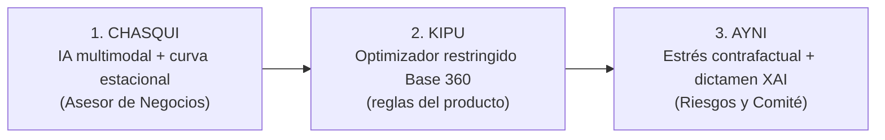

# Propuesta Ejecutiva — KipuAI
**CAJATHON 2026 · Eje 4: Inclusión Financiera y Resiliencia · Reto NEG-01**  
**Reto:** Plan de pagos adaptado al ciclo económico del negocio — *Caja Trujillo* · **Equipo:** BRADS TECH

---

## 1. Resumen de la Propuesta

**KipuAI** es un motor de originación inteligente que permite al Asesor de Negocios de **Caja Trujillo** estimar el ciclo económico y la estacionalidad de cada microempresario. Para eso cruza patrones públicos de sector, zona y clima con la evidencia operativa que el asesor captura en campo. Con ese ciclo construye, **desde cero y antes del desembolso**, un plan de pagos en el que **cada cuota tiene su propio monto y su propio periodo**.

KipuAI no es un formulario ni un dashboard. Combina cinco capacidades avanzadas en un mismo flujo:

1. **IA multimodal con salida estructurada (JSON Schema):** lee la foto del cuaderno de ventas o las notas de visita y devuelve un perfil económico tipado y validado: ventas, costos, gastos, carga familiar y 12 factores estacionales.
2. **Analítica predictiva estacional:** una curva de 12 factores mensuales que parte del patrón sector × zona y se ajusta con el cliente. Clasifica cada etapa en cima, normal o valle sin usar historial de pagos de cartera.
3. **Optimización matemática restringida (Base 360):** bisección anidada que busca el plan que liquida el crédito y respeta, en cada etapa, `Cuota_t ÷ Utilidad Neta_t ≤ Factor`. Incluye un colchón prudencial y la prelación exacta de Caja Trujillo.
4. **Riesgo probabilístico (Monte Carlo):** 1,000 trayectorias reproducibles del ciclo, con shock de nivel de ventas, ruido mensual AR(1), retraso de campaña y El Niño con severidad aleatoria. Entrega la probabilidad de impago, la pérdida esperada y el VaR 95%, y una banda de confianza P10–P90 de la utilidad neta.
5. **Simulación contrafactual explicable (XAI):** compara el plan adaptado contra la cuota fija en cuatro escenarios (base, ventas −25%, campaña +30 días y El Niño) y genera un dictamen de comité que explica por qué cada cuota sube o baja.

---

## 2. Problema actual vs. KipuAI

| Dimensión | Hoy | Con KipuAI |
| :--- | :--- | :--- |
| **Ingreso estimado** | Un solo promedio de meses altos y bajos | Curva de 12 factores (sector × zona × cliente), con etapas cima, normal y valle |
| **Cronograma** | Cuota fija y periodicidad única (limitación del core) | Cuotas y periodos distintos por etapa; **periodicidad elástica** (22 días en cima, 30 en normal, 40 en valle) |
| **Capacidad de pago** | Validada sobre el promedio | Restricción dura **en cada etapa**, más un colchón prudencial del 8% del factor |
| **Valles profundos** | Mora temprana o gracia que encarece el crédito | Prelación Seguros → Interés → Capital; lo impago queda pendiente sin capitalizarse |
| **Comité** | Sustento subjetivo | Gráfico `Cuota/Utilidad Neta` por etapa, supuestos visibles, estrés contrafactual y acta trazable |

---

## 3. Arquitectura en 3 módulos

### Módulo 1 — Chasqui: estimación del ciclo (variables internas y externas)
- **Patrones sector × zona** construidos a partir de **INEI, BCRP, MIDAGRI, SENAMHI, SUNAT, SBS, PRODUCE, la Cámara de Comercio de La Libertad y calendarios comerciales**. Arquetipos: panadería en Trujillo, confecciones y campaña escolar en El Porvenir, palta Hass y espárrago en Virú–Chao, y taller mecánico en La Esperanza. Dos negocios del mismo rubro tienen ciclos distintos según su zona.
- **IA multimodal (Gemini vía API, con JSON Schema obligatorio):** el asesor fotografía el cuaderno o las boletas, o dicta sus notas. La IA extrae ventas, costo de ventas, gastos operativos y tributarios (RUS/RER/MYPE) y carga familiar, y ajusta la curva al cliente. Cada campo pasa por validación de rangos. Si la API no responde, un **motor determinista local** permite seguir operando sin conexión al core.
- **Utilidad neta por etapa** = ventas × factor estacional − costo variable − gastos fijos − tributos − carga familiar.

### Módulo 2 — Kipu: optimizador restringido y aritmética exacta de Caja Trujillo
- **Interés por días exactos en Base 360:** `TED = (1+TEA)^(1/360) − 1` e `I_t = SaldoCapital_{t−1} × ((1+TED)^{d_t} − 1)`. La TEA es fija, editable y está limitada al tope BCRP. Las fechas se calculan en el calendario de `America/Lima`, sin desfase de días.
- **Seguros Base 360, interés simple:** desgravamen (opcional) sobre saldo; multirriesgo o vivienda (opcionales y excluyentes) sobre el valor asegurable.
- **Optimización:** una bisección anidada busca el monto de cada cuota. En **cima** amortiza el máximo capital después de seguros e intereses. En **valle** cubre primero seguros e intereses y, si alcanza, una parte del capital. Un regularizador anti-balón reparte el capital. Una segunda bisección calcula el **Monto Máximo Viable** si lo solicitado excede la capacidad.
- **Prelación (respuesta 7 del Owner):** primero los conceptos **pendientes** (seguros → interés → capital vencido) y luego los **del periodo** (seguros → interés → capital). Lo no cubierto queda en su mismo concepto: **suma al saldo de deuda, pero nunca al saldo de capital**.
- **TCEA exacta**, calculada por VAN en días exactos Base 360, para el plan adaptado y para la cuota fija con las mismas condiciones.

### Módulo 3 — Ayni: simulación contrafactual y comité explicable
- **Estrés en un clic:** KipuAI frente a cuota fija en cuatro escenarios: base, ventas −25%, retraso de campaña +30 días y **El Niño costero** (−45% en ventas entre enero y abril, con sobrecosto operativo).
- **Dictamen "abogado del diablo":** explica con cifras por qué cada cuota es alta o baja, lista los supuestos sectoriales y climáticos, evalúa los 5 riesgos y emite condiciones para el comité. **Guardarraíl:** la IA puede endurecer el veredicto, pero nunca aprobar lo que el motor determinista observa o rechaza.

---

## 4. Mitigación de los 5 riesgos del desafío (medida en el motor, no declarada)

1. **Estimación optimista:** la utilidad neta descuenta costos, gastos, tributos y carga familiar. El plan se construye primero dejando un **colchón del 8% del factor** en cada etapa. Además se somete a ventas −25%, campaña +30 días y El Niño, se informa la **holgura mínima** `Factor − Cuota/UN` del plan, y el **Monte Carlo** calcula la probabilidad de superar el tope en cada cuota.
2. **Concentración de capital:** el motor mide la **participación de la cuota con más capital**, la de las **3 cuotas mayores** y la del **último cuarto del plazo**. En el caso agrícola, ninguna cuota supera el 15.2% del capital y el último cuarto concentra solo el 9.4%.
3. **Encarecimiento del crédito:** el motor cuenta las **cuotas de solo interés o gracia de hecho** y las cuotas con conceptos pendientes, y muestra la TCEA de ambos planes lado a lado. No se programan gracias: la cuota baja solo cuando la capacidad del valle lo exige.
4. **Sobreendeudamiento:** el tope `Cuota_t ÷ UN_t ≤ Factor` se aplica en cada una de las N etapas, nunca sobre el promedio. El factor depende del producto (0.65 en Inclusión, 0.85 en Pequeña Empresa) y es configurable. Si el monto no cabe, el motor calcula el **Monto Máximo Viable**.
5. **Dependencia del modelo:** cada supuesto es visible y editable. El asesor puede **reducir el factor** con el deslizador de criterio de campo, y queda registrado en el acta. La IA no puede aprobar por encima del motor determinista.

---

## 5. Valor cuantificado (caso verificado en el prototipo)

Crédito agrícola de Pequeña Empresa, palta y espárrago en Virú–Chao: **S/ 25,000**, 12 cuotas, TEA **32.00%**, factor de campo **0.66**, periodicidad elástica.

| Indicador | Cuota fija | KipuAI |
| :--- | :--- | :--- |
| Cuota | S/ 2,463.04 cada mes | De S/ 532 (valle de 40 días) a S/ 4,161 (cosecha de 22 días) |
| Etapas que superan el tope Cuota/UN | **4 de 12** | **0 de 12** (holgura mínima de 0.15 sobre el factor) |
| Intereses totales | S/ 4,011.01 | S/ 3,174.33 (**S/ 836.68 menos**) |
| TCEA | 36.86% | 37.40% (+0.54 pp, por seguros sobre el valor asegurable y plazo efectivo más corto) |
| Escenario base: periodos con atraso > 30 días / saldo al vencimiento | 4 / S/ 883.05 | **0 / S/ 0.00** |
| Ventas −25%: periodos > 30 días / saldo al vencimiento | 7 / S/ 2,734.43 | 4 / **S/ 0.00** |
| El Niño: periodos > 30 días / saldo al vencimiento | 6 / S/ 2,463.05 | 3 / **S/ 0.00** |

*Las cifras de estrés suponen que el cliente destina como máximo el 100% de su utilidad neta del periodo a pagar. No se mide mora de cartera real, conforme a las bases.*

---

## 6. Caso de negocio para Caja Trujillo (sostenibilidad financiera)

Que el cliente pague menos intereses no significa que la Caja gane menos. KipuAI mide el **resultado económico del crédito para la Caja**:

> **Resultado = intereses cobrados + reinversión del capital recuperado a la misma TEA − saldo impago al vencimiento**

La pérdida se toma de forma conservadora, antes de garantías y cobranza. Los seguros no se cuentan, porque son de la aseguradora.

Mismo caso agrícola (S/ 25,000):

| Escenario | Resultado Caja: cuota fija | Resultado Caja: KipuAI | Ventaja KipuAI |
| :--- | :--- | :--- | :--- |
| Base | S/ 6,481.52 | S/ 7,431.72 | **+S/ 950.20** |
| Retraso de campaña +30 días | S/ 7,357.33 | S/ 7,427.96 | +S/ 70.63 |
| Ventas −25% | S/ 4,543.45 | S/ 7,427.11 | **+S/ 2,883.66** |
| El Niño | S/ 4,800.06 | S/ 7,411.17 | **+S/ 2,611.11** |

- **Rotación de capital:** la vida media del capital es de **163 días con KipuAI frente a 202 con cuota fija**. El capital vuelve 39 días antes y se puede volver a prestar.
- **Menos pérdida y menos provisiones:** en el escenario base, el crédito con cuota fija llega a categoría SBS *Deficiente*, con una provisión máxima de S/ 6,160.62. Con KipuAI se mantiene en *Normal* (S/ 247.82).
- En negocios con estacionalidad moderada (panadería, taller), el resultado en el escenario base es **equivalente** (±1%) y la ventaja aparece bajo estrés. KipuAI no le quita ingresos a la Caja: le quita riesgo.

---

## 7. Riesgo probabilístico: Monte Carlo del ciclo (1,000 trayectorias, semilla fija)

Supuestos editables:
- shock de nivel de ventas σ = 10% (error de estimación del asesor);
- ruido mensual AR(1) con σ = 7% y ρ = 0.5;
- probabilidad de retraso de campaña: 20%;
- probabilidad de El Niño: 15%, con severidad aleatoria multiplicada por la sensibilidad zonal.

Ambos planes se evalúan con **la misma trayectoria** y con la prelación de la respuesta 7.

| Indicador (caso agrícola) | Cuota fija | KipuAI |
| :--- | :--- | :--- |
| P(alguna cuota supera el 100% de la utilidad) | 95.8% | **43.8%** |
| P(atraso mayor a 30 días) | 94.1% | **40.3%** |
| P(deuda impaga al vencimiento) | 69.0% | **0.1%** |
| Pérdida esperada | S/ 1,005.61 | **S/ 0.54** |
| Pérdida P95 (VaR) | S/ 2,463.05 | **S/ 0.00** |
| Resultado esperado para la Caja | S/ 6,338.62 | **S/ 7,426.99 (+S/ 1,088.37)** |
| Resultado en el 5% de escenarios más adversos | S/ 4,794.59 | **S/ 7,409.72** |

**Validación del modelo:** con volatilidad cero, el Monte Carlo reproduce exactamente el escenario base determinista. Esa prueba es automática (`scripts/verify-risk-analytics.ts`). Sin datos de cartera (respuesta 8), la incertidumbre del ciclo se trata de forma explícita y auditable en lugar de suponer que la proyección es exacta.
